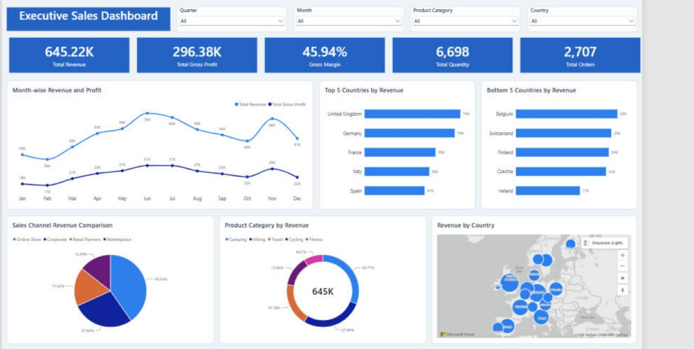

# Executive Sales Dashboard (Power BI)

An interactive, single-page executive dashboard for a European outdoor and sporting goods retailer. It turns 2,707 orders from 2026 into the questions a sales leader asks first: how much did we make, where, through which channel, and on which products.



## Headline numbers

| Total Revenue | Gross Profit | Gross Margin | Units Sold | Orders |
|---|---|---|---|---|
| 645.22K | 296.38K | 45.94% | 6,698 | 2,707 |

## Key insights

- **Revenue peaks mid-year.** June is the best month (69.5K), almost double February (35.6K). Q2 and Q3 together bring in 56% of annual revenue.
- **Sales are concentrated in a few markets.** The United Kingdom and Germany alone account for 22% of revenue, and the top 5 countries make up 46%. The UK out-sells Ireland, the smallest market, by about 4.5x.
- **Online Store is the main channel.** It drives 40% of revenue at a 47.4% margin. Corporate is the second biggest channel (28%) but has the lowest margin (42.1%), which suggests corporate discounting is worth a closer look.
- **Big categories, thinner margins.** Camping and Hiking together are 59% of revenue but have the lowest margins (42.8% and 45.1%). Fitness is the smallest category (8.6%) but the most profitable per sale (51.2% margin).

## What the dashboard includes

- **KPI cards** for Total Revenue, Gross Profit, Gross Margin, Total Quantity and Total Orders
- **Slicers** for Quarter, Month, Product Category and Country that filter every visual
- **Month-wise revenue and profit trend** (smoothed line chart with data labels)
- **Top 5 and Bottom 5 countries by revenue** (dynamic Top N filters that recalculate under any slicer selection)
- **Sales channel revenue split** (pie chart)
- **Product category revenue split** (donut chart with the total in the center)
- **Revenue by country** (Azure Maps bubble map)

## Data model

A star schema with one fact table, one date dimension and a dedicated measures table:

```
Date_Table (1) ──── (*) Sales_Data
   Date                  Order Date
   Year                  Region, Country
   Quarter               Sales Channel, Customer Type
   Month_Number          Product Category, Product
   Month_Name            Units Sold, Unit Price, Discount %
                         Unit Cost, Revenue, COGS, Gross Profit

All_Measures (measures only)
```

- **Sales_Data** is loaded from `Sales_Data.xlsx` with Power Query, with explicit data types set for all 16 columns.
- **Date_Table** is a DAX calculated table covering every day of each year in the data. It is marked as the model's date table, and Month_Name is sorted by Month_Number so months display in calendar order.
- **Auto date/time is turned off** so the model relies on the custom date table.
- The Excel file location is stored in a Power Query **parameter (`DataFolder`)**, so the source can be repointed without editing queries.

## DAX measures

```dax
Total Revenue      = SUM ( Sales_Data[Revenue] )
Total Gross Profit = SUM ( Sales_Data[Gross Profit] )
Gross Margin       = DIVIDE ( [Total Gross Profit], [Total Revenue] )
Total Quantity     = SUM ( Sales_Data[Units Sold] )
Total Orders       = DISTINCTCOUNT ( Sales_Data[ID] )
```

Date table:

```dax
Date_Table =
VAR MinYear = YEAR ( MIN ( Sales_Data[Order Date] ) )
VAR MaxYear = YEAR ( MAX ( Sales_Data[Order Date] ) )
RETURN
    ADDCOLUMNS (
        CALENDAR ( DATE ( MinYear, 1, 1 ), DATE ( MaxYear, 12, 31 ) ),
        "Year", YEAR ( [Date] ),
        "Quarter", "Q" & QUARTER ( [Date] ),
        "Month_Number", MONTH ( [Date] ),
        "Month_Name", FORMAT ( [Date], "mmm" )
    )
```

## Dataset

`Sales_Data.xlsx`: 2,707 order lines from January to December 2026 across 17 countries in 4 European regions, 4 sales channels, 3 customer types, 5 product categories and 20 products. Each row has units, unit price, discount, unit cost, revenue, COGS and gross profit.

## Repository structure

This project is saved in Power BI Project (PBIP) format, so the report and model are stored as readable text files that work with Git:

```
Executive Sales Dashboard.pbip                  open this in Power BI Desktop
Executive Sales Dashboard.SemanticModel/
    definition/tables/*.tmdl                    tables, columns, measures (TMDL)
    definition/relationships.tmdl
    definition/expressions.tmdl                 DataFolder parameter
Executive Sales Dashboard.Report/
    definition/pages/.../visuals/*/visual.json  each visual (PBIR)
    StaticResources/RegisteredResources/        custom color theme
```

## How to open it

1. Install [Power BI Desktop](https://www.microsoft.com/power-bi/desktop) (Windows).
2. Clone or download this repository (`Sales_Data.xlsx` is included).
3. Open `Executive Sales Dashboard.pbip`.
4. Go to **Transform data > Edit parameters** and set `DataFolder` to the folder that contains `Sales_Data.xlsx` (keep the trailing backslash).
5. Click **Refresh**.

## Tools

Power BI Desktop, Power Query (M), DAX, TMDL and PBIR (Power BI Project format), Azure Maps

---

Built by Shreya Katiyar · [LinkedIn](https://linkedin.com/in/shreyakat) · [GitHub](https://github.com/shreyakat21) · [shreyakatiyar.com](https://shreyakatiyar.com)
